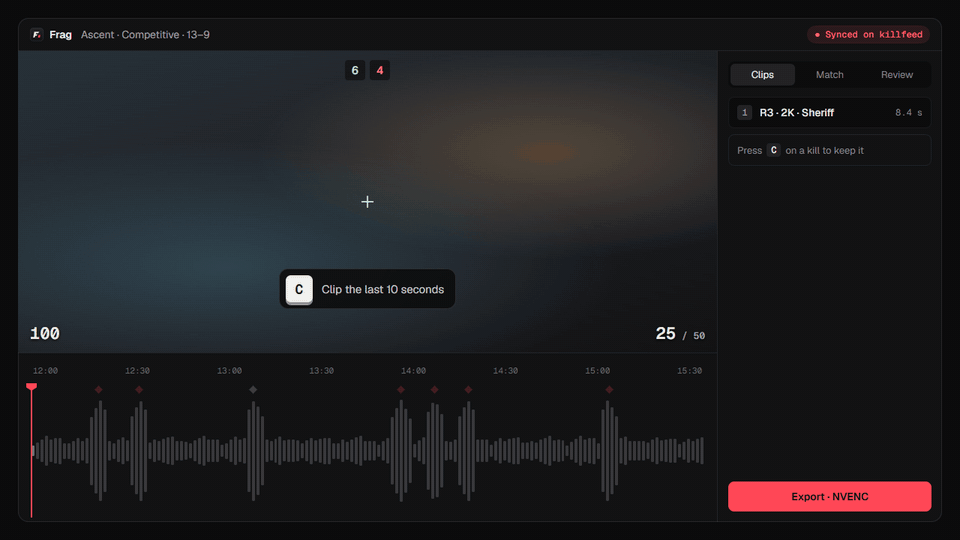

<p align="center">
  
</p>

<p align="center">
  <a href="https://github.com/delusionallov3/frag/releases/latest"></a>
  <a href="https://github.com/delusionallov3/frag/releases"></a>
  
  
  
  
  
</p>

<p align="center">
  <b>Turn your Valorant recordings into clips in a few keystrokes.</b><br>
  Frag records your games with OBS, links each recording to its match, puts your kills on the timeline<br>
  and exports frame-accurate clips with NVENC. Everything runs on your PC.
</p>

<p align="center">
  <a href="https://github.com/delusionallov3/frag/releases/latest"><b>Download for Windows</b></a>
</p>

<p align="center">
  
</p>

---

## What it does

- **Records for you.** Frag watches Valorant and tells OBS to start when the game loads and stop when you're back in the menus. You don't press anything.
- **Knows what happened.** Each recording is matched to its game through the HenrikDev API. Kills, deaths, plants and rounds land on the timeline, synced to the frame.
- **Clips in one key.** Press `C` and you get the last 10 seconds. Or let Frag cut every 3K, ace and clutch for you.
- **Exports fast.** Frame-accurate cuts on your Nvidia GPU, or instant lossless cuts. Keep your audio tracks split or mix them for Discord.
- **Helps you get better.** The Review tab plays back your deaths, first deaths, untraded deaths and lost clutches. Tag your mistakes and the Stats page shows what keeps happening.
- **Makes montages.** Pick clips from any game, add a title card, export.
- **Stays out of the way.** Close the window and Frag keeps running in the tray. You get a notification when a game is linked or when OBS isn't open.

Frag is available in English and French, and updates itself from GitHub releases.

## Getting started

1. Grab `Frag-Setup-x.y.z.exe` from the [latest release](https://github.com/delusionallov3/frag/releases/latest) and run it.
   Windows may say it protected your PC: click **More info → Run anyway** (the app isn't code-signed).
2. Pick the folder where OBS saves your recordings.
3. Optional but worth it:
   - **Auto-record:** in OBS, open *Tools → WebSocket Server Settings*, enable the server and copy the password into Frag's settings.
   - **Match data:** get a free key at [api.henrikdev.xyz](https://api.henrikdev.xyz/dashboard/), paste it in Settings and add your Riot ID.

That's it. Play a game, come back, your recording is there and already linked.

## Shortcuts

| Key | Action |
| --- | --- |
| `Space` | Play / pause |
| `←` `→` | Frame by frame (`Shift` for ± 1 s) |
| `J` `L` | ± 5 s |
| `C` | Clip the last 10 seconds |
| `I` `O` | Set clip start / end |
| `M` | Drop a marker |
| `N` | Next kill (`Shift` for previous) |
| `E` | Export the selected clip (`Shift` for all checked clips) |
| `Ctrl` `Z` | Undo |
| `?` | All shortcuts |

Shortcuts are QWERTY by default. On an AZERTY keyboard, switch the layout in Settings and the symbol keys follow.

## Build from source

You need [Node.js](https://nodejs.org) 20 or later.

```bash
npm install
npm run dev        # run the app with hot reload
npm run typecheck  # type checks
npm run dist       # build the Windows installer into release/
```

FFmpeg and FFprobe come from npm, nothing else to install.

```
src/main       Electron main process: files, FFmpeg, OBS, HenrikDev, exports, tray, updates
src/preload    the bridge between the UI and the system
src/renderer   React UI: library, editor, timeline, stats, montage
src/shared     types, translations, changelog
```

### Releasing

1. Bump `version` in `package.json` and add an entry to `src/shared/changelog.ts`.
2. Commit, tag (`git tag vX.Y.Z`) and push the tag.
3. `npm run dist`, then create a GitHub release on that tag with the three files from `release/`: `Frag-Setup-X.Y.Z.exe`, its `.blockmap` and `latest.yml`. Installed copies pick it up on their own.

## Privacy

Your clips, notes and settings stay in `%APPDATA%\Frag`. The only network calls are to HenrikDev (match data, with your key), valorant-api.com (agent and map images, cached) and GitHub (update checks). Your HenrikDev key and OBS password are encrypted with Windows' own storage.

## Credits

Match data from the [HenrikDev Valorant API](https://github.com/Henrik-3/unofficial-valorant-api). Game assets from [valorant-api.com](https://valorant-api.com). Video work by [FFmpeg](https://ffmpeg.org).

<sub>Frag isn't endorsed by Riot Games and doesn't reflect the views or opinions of Riot Games or anyone officially involved in producing or managing Riot Games properties. Riot Games and all associated properties are trademarks or registered trademarks of Riot Games, Inc.</sub>
